# TME guide: install, set up and use

TME is an expense tracker for iPhone. Your bank's SMS alerts log themselves, a small banner asks you which category each payment belongs to, and everything stays on your iPhone.

TME isn't on the App Store. You install it yourself, for free, with your own Apple Account. This guide takes you through it step by step.

**Which part should I read?**

- **No Mac** (you have Windows or Linux): read [Install without a Mac](#2-install-without-a-mac).
- **You have a Mac**: read [Install with a Mac](#3-install-with-a-mac). If you'd rather not install Xcode, the "without a Mac" way works on a Mac too.
- **Everyone**, once TME is installed: [Set up TME](#4-set-up-tme), then [Using TME every day](#5-using-tme-every-day).

## 1. Before you start

You need:

- An **iPhone on iOS 26 or later**. To check, open **Settings → General → About** and look at **iOS Version**.
- An **Apple Account**: the email and password you use for the App Store. A normal free one is fine. You don't pay for anything.
- A **cable** to connect your iPhone to the computer, for the first setup.
- About **30 to 45 minutes** the first time.

**One thing to know first.** Apple lets you put apps on your own iPhone with a free Apple Account, but those apps stop opening after **7 days** unless they're renewed. Both ways below can renew TME for you, and renewing never deletes your data.

## 2. Install without a Mac

You'll install a free helper app called **SideStore** on your iPhone. You need your computer only once, to set SideStore up. After that, SideStore installs TME, renews it and updates it, all on the iPhone.

These steps are for **Windows**. 32-bit Windows and Windows 10 on Arm aren't supported. The tool you'll use, iloader, also has Mac and Linux versions; [SideStore's guide](https://docs.sidestore.io/docs/installation/prerequisites) says what those need instead of Step 1.

### Step 1: Get your computer ready

1. Install **iTunes** from Apple's website: <https://www.apple.com/itunes/download/win64>. (The Microsoft Store version can work, but SideStore recommends Apple's.)
2. Download **iloader** from <https://github.com/nab138/iloader/releases/latest>. Under **Assets**, click `iloader-windows-x64.msi`. Open the file and install it.

### Step 2: Get your iPhone ready

1. On your iPhone, install **LocalDevVPN** from the App Store: <https://apps.apple.com/app/localdevvpn/id6755608044>. It's free.
2. Open LocalDevVPN and tap **Connect**. If your iPhone asks you to **Allow VPN Configurations**, tap **Allow** and enter your passcode.

SideStore needs LocalDevVPN to install and renew apps by itself, without a computer.

### Step 3: Install SideStore

1. Connect your iPhone to the computer with the cable, and unlock the iPhone. If it asks **Trust This Computer?**, tap **Trust** and enter your passcode.
2. On the computer, open **iloader**.
3. Sign in with your Apple Account. Type your email exactly as it is, because capital letters matter. If Apple sends you a code, enter it.
4. Select your iPhone.
5. Click **Install SideStore (Stable)** and wait for it to finish.

### Step 4: Allow SideStore on your iPhone

1. Open **Settings → General → VPN & Device Management**. Under **Developer App**, tap your Apple Account email. Tap **Trust**, then **Allow & Restart**, and enter your passcode. Your iPhone restarts.
2. Open **Settings → Privacy & Security**, scroll to the bottom and tap **Developer Mode**. Turn it on and tap **Restart**. After the restart, tap **Turn On** and enter your passcode.
3. Open **LocalDevVPN** and tap **Connect**.
4. Open **SideStore** and sign in with the **same** Apple Account you used in iloader.
5. Go to **My Apps**. Next to SideStore, tap the **7 DAYS** counter. If SideStore asks about your certificate, tap **Yes** or **Refresh Now**.

You can unplug the cable now. You won't need the computer again unless SideStore itself runs out (see [Keep TME working](#keep-tme-working-without-a-mac) below).

### Step 5: Install TME

Tip: open this guide on your iPhone, so you can copy the address in step 2 and paste it into SideStore.

1. Make sure LocalDevVPN says it's connected.
2. In SideStore, open the **Sources** tab and tap **+**. Paste this address, add it, and tap **Add Source** to confirm:

   ```
   https://github.com/codeitkrishna/track-my-expenses/releases/latest/download/source.json
   ```

3. Open the **Browse** tab, find **TME**, and tap **Free** (or **Install**).
4. If SideStore says **App Contains Extensions**, choose **Keep App Extensions (Register App ID for Each Extension)**. TME's category banner is one of those extensions. If you remove it, the banner won't appear.
5. When it's done, TME is on your Home Screen. Now go to [Set up TME](#4-set-up-tme).

### Keep TME working (without a Mac)

- **Renew once a week.** Open LocalDevVPN and tap **Connect**. Then open SideStore, go to **My Apps** and tap **Refresh All**. The counters go back to 7 days. Your data stays.
- **Don't let SideStore run out.** If SideStore's own counter reaches 0, it stops opening, and you'll need the computer to set it up again (Steps 3 and 4).
- **Updates.** When there's a new version of TME, it shows up in **My Apps** with an **Update** button. Connect LocalDevVPN and tap it. Your data stays.
- **Apple's limits on free accounts.** You can have 3 apps like this at a time; SideStore and TME use 2 of them. You can also add only 10 new app IDs a week; TME uses 2 the first time you install it.

## 3. Install with a Mac

You'll build TME on your Mac with **Xcode**, Apple's free app-making tool, and put it on your iPhone. Your Mac can then renew TME for you automatically.

Xcode is a very big download. If you'd rather skip it, follow [Install without a Mac](#2-install-without-a-mac) instead, and download the Mac version of iloader (`iloader-darwin-universal.dmg`).

### Step 1: Install Xcode and sign in

1. Open the **App Store** on your Mac, search for **Xcode** and install it. TME needs **Xcode 27**.
2. Open Xcode. Agree to the license if it asks. If it asks which platforms to download, make sure **iOS** is included, and wait for it to finish.
3. In the menu bar, click **Xcode → Settings**, then **Apple Accounts**. Click **+** and sign in with your Apple Account. You'll see your name followed by **(Personal Team)**.

### Step 2: Download TME

1. Open **Terminal**: press **Cmd + Space**, type `Terminal` and press Return.
2. Copy these two lines, paste them into Terminal and press Return:

   ```sh
   cd ~/Documents
   git clone https://github.com/codeitkrishna/track-my-expenses.git
   ```

This puts TME in a folder called `track-my-expenses` inside your Documents folder. Leave the folder there, because automatic renewal (Step 5) uses it.

### Step 3: Add your Team ID

Xcode needs your **Team ID**, a 10-character code that Apple gives every Apple Account.

1. In Terminal, paste this and press Return:

   ```sh
   defaults read com.apple.dt.Xcode IDEProvisioningTeamByIdentifier | grep teamID
   ```

   You'll see a line like `teamID = ABCDE12345;`. Those 10 letters and numbers are your Team ID. If nothing appears, check that you signed in to Xcode in Step 1.

2. Paste these lines and press Return. They create your settings file and open it in TextEdit:

   ```sh
   cd ~/Documents/track-my-expenses
   cp Config/Signing.example.xcconfig Config/Signing.xcconfig
   open -e Config/Signing.xcconfig
   ```

3. In TextEdit, change two lines:
   - `DEVELOPMENT_TEAM = ABCDE12345`: replace `ABCDE12345` with your Team ID.
   - `BUNDLE_ID_PREFIX = com.yourname`: replace `com.yourname` with something that's yours, like `com.priya.sharma`. Use only lowercase letters, numbers and dots. Nobody else can be using it.
4. Save with **Cmd + S** and close TextEdit.

### Step 4: Put TME on your iPhone

1. Open the project. In Terminal, paste this and press Return:

   ```sh
   open ~/Documents/track-my-expenses/TME.xcodeproj
   ```

2. Connect your iPhone to the Mac with the cable and unlock it. If it asks **Trust This Computer?**, tap **Trust** and enter your passcode.
   - On **iOS 27** you can skip the cable: in Xcode's **Device Hub**, click **+**, then **Pair Nearby Device**.
3. Turn on Developer Mode on the iPhone: open **Settings → Privacy & Security**, scroll to the bottom and tap **Developer Mode**. Turn it on and tap **Restart**. After the restart, tap **Turn On** and enter your passcode. (This option appears once the iPhone has been connected to Xcode.)
4. At the top of the Xcode window, click the device menu next to **TME** and choose your iPhone.
5. Click the **Run** button (▶), or press **Cmd + R**. Xcode builds TME and installs it on the iPhone. The first time, this can take a few minutes.
   - If your Mac asks for your password so that **codesign** can use a key, type your Mac's login password and click **Always Allow**.
   - If Xcode says the bundle identifier isn't available, someone already uses your `BUNDLE_ID_PREFIX`. Choose a different one in `Config/Signing.xcconfig` and press Run again.
6. On the iPhone, open **Settings → General → VPN & Device Management**. Under **Developer App**, tap your Apple Account email and tap **Trust**. If it asks to restart, let it.
7. Open TME. Now go to [Set up TME](#4-set-up-tme).

### Step 5: Keep TME working (with a Mac)

Let your Mac renew TME by itself. In Terminal, paste these lines and press Return. You only do this once:

```sh
cd ~/Documents/track-my-expenses
scripts/install-renew-agent.sh
```

- Every 6 hours, and whenever your Mac wakes up, it checks how many days TME has left. With 3 days or less, it renews TME and reinstalls it over Wi-Fi. Your data stays.
- For this to work, your Mac needs to be on now and then, Xcode needs to stay signed in, and your iPhone needs to be on the same Wi-Fi as the Mac.
- If it can't renew, your Mac shows a notification telling you why.
- To turn it off, run `scripts/install-renew-agent.sh --remove` in the same folder.
- You can also renew by hand: open the project in Xcode and press **Run** again before the 7 days are up.

**To get a newer version of TME**, paste this in Terminal, then press **Run** in Xcode. Your data stays.

```sh
cd ~/Documents/track-my-expenses
git pull
```

## 4. Set up TME

Do these once, after installing. They take about 15 minutes. In TME, **Settings** is the gear at the top right.

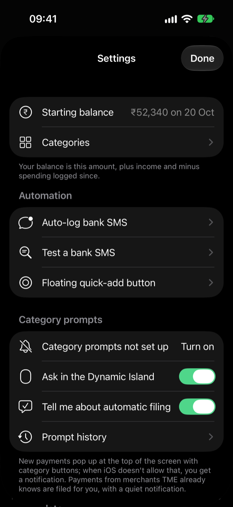

### Allow notifications

The first time you open TME, your iPhone asks whether TME may send notifications. Tap **Allow**. TME uses them to ask for a payment's category when it can't show the banner at the top of the screen.

If you tapped **Don't Allow**: in TME, go to **Settings**. Under **Category prompts**, tap **Open Settings** and turn on **Allow Notifications**.

### Set your starting balance

TME can show your bank balance and keep it up to date.

1. On the main screen, tap **Set** under **Balance**. (Or go to **Settings → Starting balance**.)
2. Type how much is in your account right now. Put a minus sign in front if you owe money.
3. **As of** is when that amount was right. Leave it as it is, unless you checked your balance earlier.
4. Tap **Save**.

From then on, income adds to your balance and spending takes from it. You can change it any time by tapping your balance.

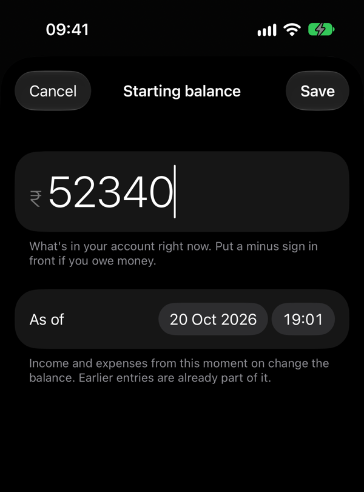

### Check your categories

TME starts with these categories:

- **Spending:** Food, Groceries, Transport, Shopping, Bills, Rent, Health, Entertainment, Other.
- **Income:** Salary, Refund, Other income.

To change them, go to **Settings → Categories**. Tap a category to rename it or change its colour and icon. Tap **Add expense category** or **Add income category** to make a new one. You can also make new categories later, while filing a payment.

### Make bank SMS log themselves

This is TME's main feature. iPhone apps can't read your messages, but the **Shortcuts** app can hand each bank SMS to TME the moment it arrives.

**First, check that TME understands your bank's SMS:**

1. In **Messages**, press and hold a recent bank SMS about a payment, and tap **Copy**.
2. In TME, go to **Settings → Test a bank SMS** and paste it.
3. TME shows what it read: the type, amount, merchant and account. If it says **Not a transaction, so it would be ignored**, TME can't read that message.

TME reads SMS from HDFC, SBI, ICICI, Axis and Kotak (UPI, cards, NEFT and refunds).

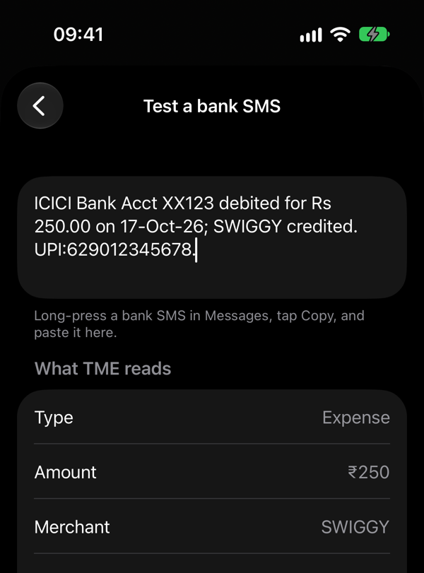

**Then make the automations**, one for each word in the list further down:

1. Open the **Shortcuts** app, tap **Automation** at the bottom, then tap **+** to make a new one.
2. Choose **Message**.
3. Set **Message Contains** to `debited`. Leave the sender empty, because you can't pick a bank's sender name.
4. Choose **Run Immediately**, and turn off **Notify When Run**. Tap **Next**.
5. Start a blank automation and tap **Add Action**. Search for **Log Bank SMS** (it's from TME) and tap it.
6. In the action, tap **Message** and pick **Shortcut Input**.
7. Tap **Done**.

Now do the same for each of these words. Each automation can only look for one word.

```
debited
credited
spent
Sent Rs
```

TME lists these words too, with copy buttons, in **Settings → Auto-log bank SMS**.

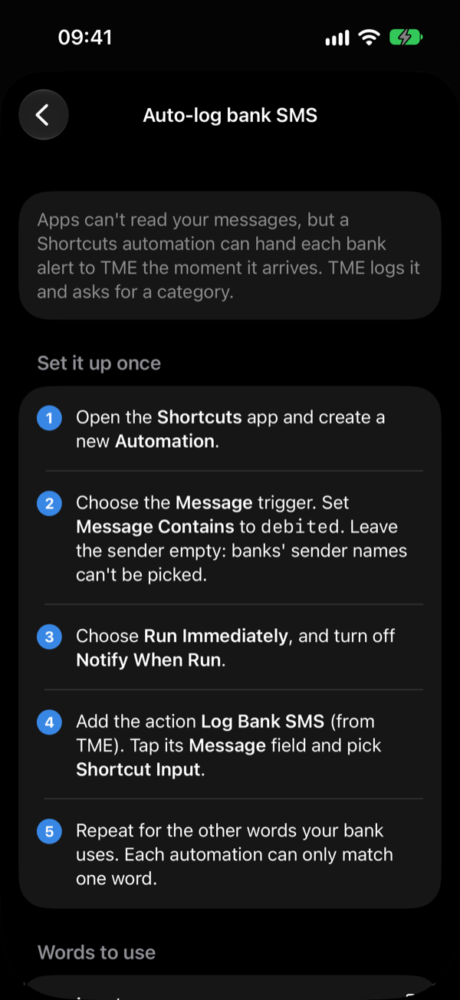

Good to know:

- OTPs, bill reminders and offers are ignored, even if they contain these words.
- If the same payment arrives twice, TME logs it once.
- Some banks don't send an SMS for small UPI payments. HDFC, for example, skips payments of ₹100 and under. Add those yourself with **+**.

### Choose how TME asks for categories

In **Settings**, under **Category prompts**:

- **Category prompts are on** means you're all set. If it says they're off or not set up, tap **Turn on** or **Open Settings**.
- **Ask in the Dynamic Island** (on to start with): new payments pop up at the top of the screen with category buttons.
- **Tell me about automatic filing** (on to start with): when TME files a payment by itself, you get a quiet notification, so you can change it if it's wrong.
- **Prompt history** shows what TME did with each SMS. Look here if a payment didn't show up.

### Optional: a floating quick-add button

iPhone's **AssistiveTouch** button floats over every app. You can set it up to add expenses to TME without opening the app.

First, make the shortcuts:

1. In **Shortcuts**, tap **+**, add the action **Add Expense** (from TME), and name the shortcut "Add Expense".
2. Do the same for **Add Income** and **Add Category**.
3. Make one more with the action **Open App** set to **TME**, and name it "Open TME".

Then turn on the button:

4. Go to **Settings → Accessibility → Touch → AssistiveTouch** and turn it on.
5. Tap **Customize Top Level Menu**. Set it to 3 icons and pick **Add Expense**, **Add Income** and **Add Category**.
6. Under **Custom Actions**, set **Long Press** to **Open Menu** and **Single-Tap** to **Open TME**.

Now press and hold the button and tap **Add Expense**. A small box asks for the amount and category, over whatever app you're using.

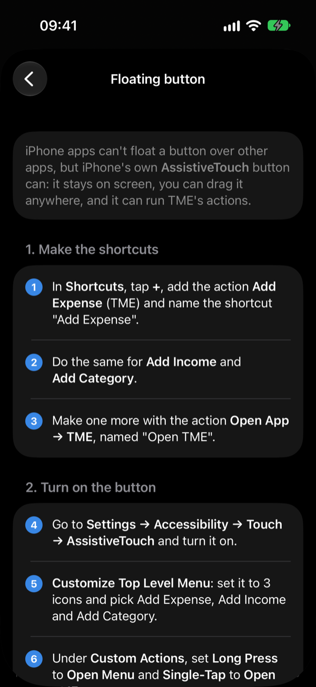

Don't want a button? **Settings → Accessibility → Touch → Back Tap** can run **Add Expense** when you double-tap the back of your iPhone.

You can also ask **Siri**: "Add an expense in TME", "Add income in TME" or "Add a category in TME".

## 5. Using TME every day

### When a bank SMS arrives

A banner appears at the top of the screen with the amount and who you paid (for example **₹250 to Swiggy**), and asks **Which category?** Press and hold it, then tap the category. That's it.

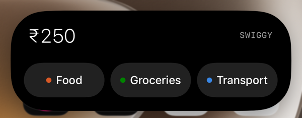

- If the banner can't appear, you get a notification instead. Press and hold it and tap the category, or tap **Type a category…** to make a new one.
- On the Lock Screen, tap the category, or tap **Tap here for another category** to pick a different one in TME.
- TME remembers your choice. Next time you pay the same merchant, TME files it by itself and sends a quiet notification such as "Filed under Food. Press and hold to change."

### Payments waiting for a category

If you miss a banner, the payment waits for you.

- At the bottom left, tap the button that says how many are waiting, for example **3 to file**. You see one payment at a time. Tap its category, or tap **Skip for now** (or swipe the card away) to leave it for later.
- Or tap the payment in the list, and category buttons appear under it.

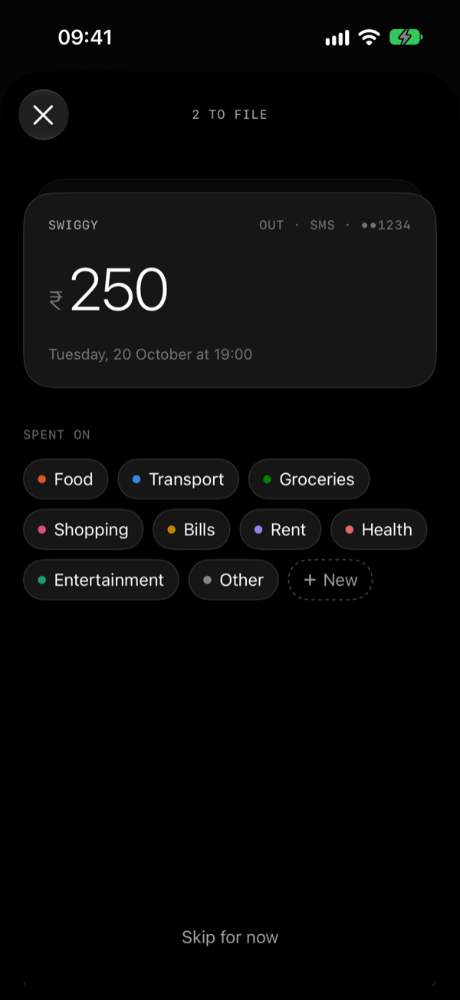

### Add a payment yourself

1. Tap **+** at the bottom right. To add income or a new category instead, touch and hold **+**.
2. Make sure **Expense** or **Income** is selected at the top.
3. Type the amount on the keypad.
4. Tap **to someone** and type who you paid. After 2 letters, TME suggests people and shops you've paid before, with the category you usually use for them.
5. Pick a category.
6. If you want, add a **Note**, **Split** it with friends (see below), or tap the date button (it says **Today** and the time) to change when it happened.
7. Tap **Save**.

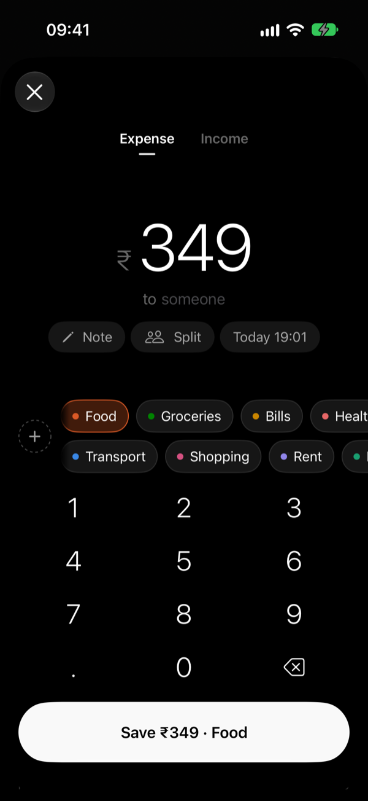

### Change or delete a payment

- Tap a payment to change it.
- Swipe it to the left to delete it. Or press and hold it and tap **Delete**.

### Read your month

- **At the top:** your **Balance** (if you set one), then **Spent**, **In** and **Net** for the month.
- **The strip of days:** touch and hold it, then slide your finger to move through the days. The list follows.
- **Categories:** under the strip, tap a category (like **Rent 66%**) to see only its payments. Tap **Show all** to see everything again.
- **Another month:** tap the month name at the top, or scroll to the bottom and tap the month before.
- **Most paid:** at the bottom, the people and shops you paid most this month.

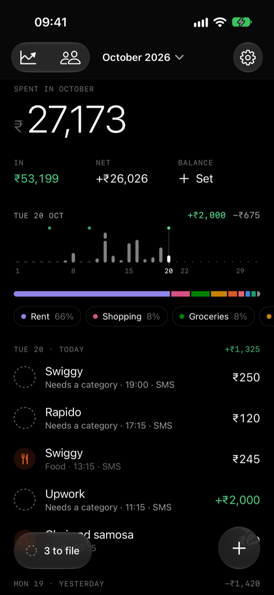

### See your trends

Tap the chart icon at the top left. Pick a period: **7D**, **30D**, **3M**, **6M**, **1Y**, or **Custom** for your own dates. TME shows how your spending compares with the period before, a chart you can touch to see each day, each category's trend, and who you paid most.

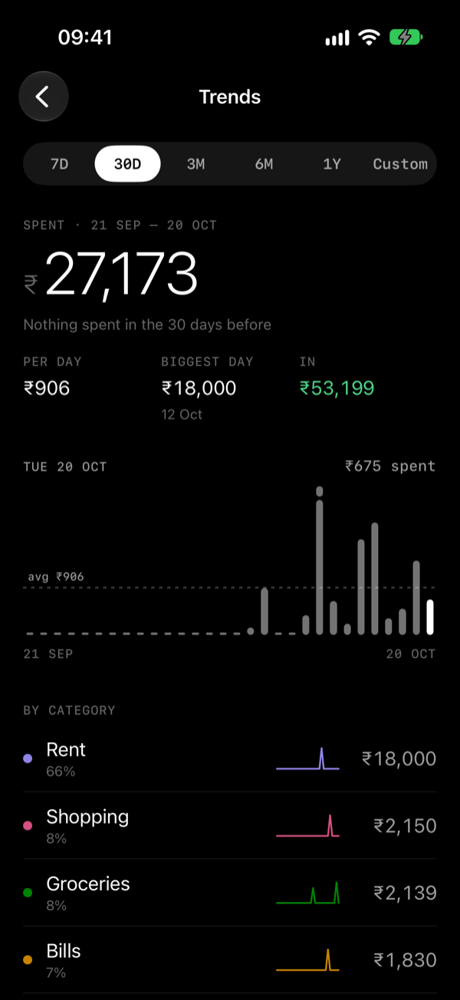

### Split a payment with friends

1. When you add or change a payment, tap **Split**.
2. Tap **Add a friend** and type a friend's name. Do this for everyone who shared it.
3. Choose how to split it: **Equal**, **Amounts** or **%**. If none of it was for you, turn off the switch next to **You**.
4. Tap **Done**, then **Save**.

To see who owes you, tap the people icon at the top left (**Friends**). Tap a friend, and then:

- tap **✓** next to a payment when they pay you back,
- tap **Settle all** when they've paid you everything,
- tap **Add** to note down money you lent them,
- tap **Share** to send them a picture of what they owe.

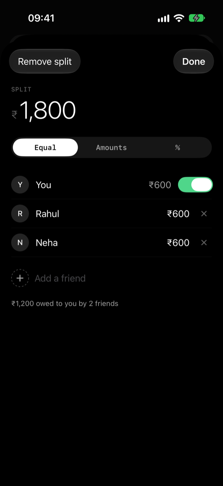 

### Your data

- Everything stays on your iPhone. No accounts, no servers, no bank logins.
- Your data is included in your normal iPhone backups.
- For a spreadsheet of everything, go to **Settings → Export as CSV**.

## 6. If something goes wrong

**TME won't open.** Its 7 days have run out. Your data is still there; just renew it:

- Without a Mac: open LocalDevVPN and tap **Connect**, then open SideStore, go to **My Apps** and tap **Refresh All**.
- With a Mac: open the project in Xcode and press **Run**. If you use automatic renewal, make sure the iPhone is on the same Wi-Fi as the Mac.

**A bank SMS didn't show up in TME.** In TME, go to **Settings → Prompt history**.

- If there's nothing there, the automation didn't run. In Shortcuts, check that it's set to **Run Immediately**, looks for the right word, and passes **Shortcut Input** to **Log Bank SMS**.
- If it says the SMS "isn't a transaction", paste that SMS into **Settings → Test a bank SMS** to see what TME reads.

**No banner asks for the category.** In TME, check **Settings → Category prompts**. In the iPhone's **Settings → Apps → TME**, check that **Notifications** are allowed and **Live Activities** is on.

**SideStore can't install or refresh.** Make sure LocalDevVPN is connected and you're on Wi-Fi. If it still fails (this can happen after an iOS update), connect the iPhone to your computer and do [Step 3: Install SideStore](#step-3-install-sidestore) again.

**"Maximum number of apps."** A free Apple Account can have only 3 apps like this at a time. Remove one you don't use.
